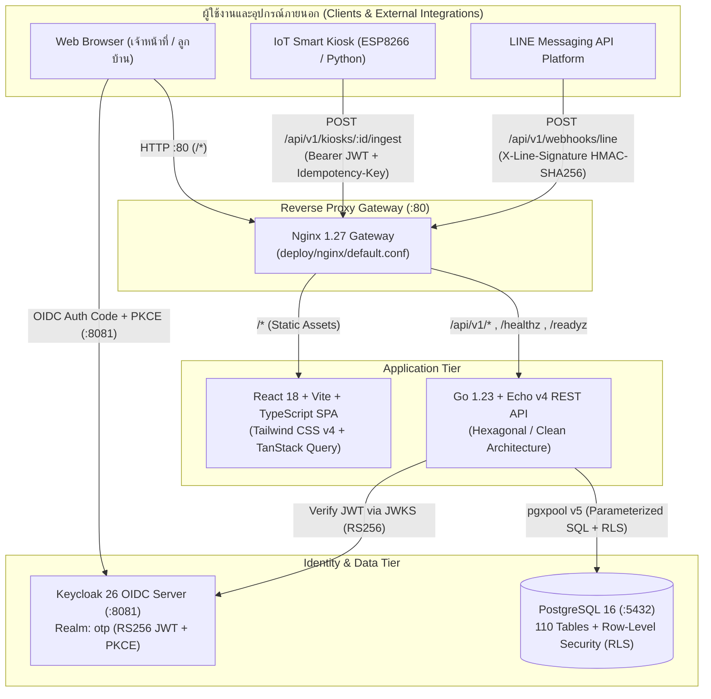
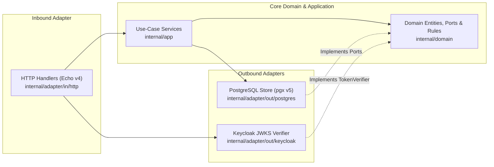

# สรุปสถาปัตยกรรมระบบ OTP Municipal Platform v2.0 (Architecture Summary)

เอกสารฉบับนี้สรุปสถาปัตยกรรมของระบบ **OTP Municipal Platform v2.0** ซึ่งได้ย้ายและยกระดับจากระบบเดิม (`otp2025` — Laravel 11 + MySQL) มาเป็นสถาปัตยกรรมสมัยใหม่แบบ **Multi-Tenant Cloud-Native Application** ด้วย **Go 1.23 + React 18 + PostgreSQL 16 + Keycloak 26 OIDC**

---

## 1. แผนผังสถาปัตยกรรมภาพรวม (High-Level System Architecture)

---

## 2. โครงสร้างแต่ละเลเยอร์ (Layered Architecture)

### 2.1 API Gateway & Container Infrastructure (`deploy/`)
- **Nginx Gateway (`:80`)** (`deploy/nginx/default.conf`):
  - เป็น Single Entrypoint รับคำขอทั้งหมดจากผู้ใช้งานและอุปกรณ์ภายนอก
  - เส้นทาง `/*` ส่งต่อไปยัง `otp-frontend` (React SPA)
  - เส้นทาง `/api/v1/*`, `/healthz`, `/readyz` ส่งต่อไปยัง `otp-backend` (Go API)
- **Docker Compose (`deploy/docker-compose.yml`)**:
  - ประกอบด้วย 5 เซอร์วิสหลัก: `otp-postgres`, `otp-keycloak`, `otp-backend`, `otp-frontend`, และ `otp-gateway` พร้อม Healthcheck ครบทุกตัว

---

### 2.2 Frontend Architecture — Feature-Sliced SPA (`frontend-react/`)
พัฒนาด้วย **React 18 + TypeScript + Vite 6 + Tailwind CSS v4 + TanStack Query v5**:
- **`src/app/`**:
  - `Layout.tsx`: โครงสร้างหลักของหน้าเว็บ (Sticky Glassmorphism Header, Pill Navigation, User Profile Chip, และ System Footer)
  - `router.tsx`: กำหนด Routing ทั้งหมดและผูก Role Guard (`RequireRole`) ตามสิทธิ์ในแต่ละโมดูล
  - `pages.tsx`: หน้าแรก (`HomePage` พร้อม Hero Banner และการ์ดทางลัดเข้าโมดูล), หน้า `403 Forbidden`, และ `404 Not Found`
- **`src/features/auth/`**:
  - เชื่อมต่อ Keycloak OIDC ด้วย Authorization Code Flow + PKCE (`oidc-client-ts`)
  - ถอดรหัส JWT Claims (`sub`, `preferred_username`, `roles`, `org_id`) และจัดการ `ProtectedRoute` / `Can`
- **`src/features/modules/`**:
  - `ModulesPages.tsx` และ `api.ts`: รวมหน้าจอและฟังก์ชันเชื่อมต่อ API ของทั้ง 5 Business Waves พร้อม Modal พิมพ์ใบเสร็จค่าน้ำประปา (`PrintableInvoiceModal`) และฟังก์ชันส่งออก CSV (`exportRowsToCsv`)
- **`src/shared/`**:
  - `api/client.ts`: Axios Instance พร้อม Request/Response Interceptor แนบ `Authorization: Bearer <token>` และรองรับ Error มาตรฐาน RFC 7807
  - `config/`: โหลดค่าคอนฟิกแบบ Runtime จาก `/config.js` (`window.__APP_CONFIG__`) ทำให้ใช้ Docker Image เดียวกันได้ทุก Environment

---

### 2.3 Backend Architecture — Hexagonal / Clean Architecture (`backend-go/`)
แยก Business Logic ออกจาก HTTP Framework และฐานข้อมูลอย่างเด็ดขาด:

1. **Domain Layer (`internal/domain/`)**:
   - `modules.go`: นิยาม Entities และ Repository Interfaces (Outbound Ports) ของทุกโมดูล
   - `mutations.go`: นิยาม Commands, กฎการตรวจสอบข้อมูล (`Validate()`), สูตรคำนวณค่าน้ำประปาอัตราก้าวหน้า (`CalculateProgressiveWaterBill`), สูตรคำนวณคาร์บอนเครดิต (`CalculateCarbonSavedKg`), การตรวจรหัสยืนยันผูก LINE (`VerifyLineLinkingCode`), และการตรวจลายเซ็น `X-Line-Signature` (`VerifyLineWebhookSignature`)
2. **Application Layer (`internal/app/`)**:
   - `modules_service.go` และ `mutations_service.go`: ควบคุม Use-Case และบังคับใช้ **Multi-Tenant Scoping (`scopedOrgID`)** โดยอัตโนมัติ
3. **Inbound HTTP Adapter (`internal/adapter/in/http/`)**:
   - `server.go` และ `modules_handler.go`: จัดการ Routing, Middleware ตรวจสอบ JWT + RBAC Role Guard, ระบบป้องกันการส่งซ้ำด้วย `Idempotency-Key`, และการแปลง Error เป็น **RFC 7807 Problem Details (`application/problem+json`)**
4. **Outbound Adapters (`internal/adapter/out/`)**:
   - `postgres/`: รันคำสั่ง SQL และ Atomic CTE Transactions ผ่าน `pgxpool` v5 (`modules_postgres.go`, `mutations_postgres.go`)
   - `keycloak/`: ดึง Public Key (JWKS) จาก Keycloak เพื่อตรวจสอบลายเซ็น RS256 JWT (`verifier.go`)

---

## 3. โมดูลธุรกิจทั้ง 5 Waves (Business Modules Coverage)

| Wave | โมดูล | ฟีเจอร์หลัก (Read + Write/Workflow) | Endpoints หลัก |
| :--- | :--- | :--- | :--- |
| **Wave 1** | **Organizations & Profile** | ดูข้อมูลโปรไฟล์ OIDC และรายการองค์กรตามสิทธิ์ (`org_id`) | `GET /api/v1/me` `GET /api/v1/organizations` |
| **Wave 1.5** | **Users, Zones, LINE OA & Resident Portal** | สร้างผู้ใช้งานใหม่, สร้างโซน/หมู่บ้านใหม่, ผูกบัญชี LINE แบบยืนยันตัวตน, และหน้าพอร์ทัลลูกบ้าน | `GET/POST /api/v1/users` `POST /api/v1/users/:id/link-line` `GET/POST /api/v1/zones` `GET /api/v1/resident/overview` |
| **Wave 2** | **Inventory Management** | ทะเบียนพัสดุ/เคมีภัณฑ์, สร้างใบขอเบิกพัสดุ, และอนุมัติ/ปฏิเสธรายการเบิก (`APPROVED` / `REJECTED`) | `GET/POST /api/v1/inventory/items` `GET/POST /api/v1/inventory/transactions` `POST /api/v1/inventory/transactions/:id/decision` |
| **Wave 3** | **FoodWaste & Carbon Credit** | เปิดรอบถังหมักรักษ์โลก, บันทึกน้ำหนักขยะอินทรีย์, และคำนวณคาร์บอนเครดิต (`kgCO2e`) | `GET /api/v1/foodwaste/summary` `POST /api/v1/foodwaste/batches` `POST /api/v1/foodwaste/logs` |
| **Wave 4** | **Recycle Bank (KeptKaya) & Submodules** | รับซื้อขยะรีไซเคิล, ถอนเงินสะสมสมาชิก, ปรับราคารับซื้อขยะ, ตู้ Kiosk IoT, และกองทุนสวัสดิการชุมชน | `GET /api/v1/recycle/items` `POST /api/v1/recycle/items/:id/price` `GET /api/v1/recycle/accounts` `POST /api/v1/recycle/purchases` `POST /api/v1/recycle/withdrawals` `GET /api/v1/recycle/submodules` |
| **Wave 5** | **Tabwater (ประปาหมู่บ้าน)** | เปิดรอบบิลประจำเดือน, ขึ้นทะเบียนมิเตอร์ใหม่, จดเลขมิเตอร์/คำนวณค่าน้ำอัตราก้าวหน้า + VAT 7%, รับชำระเงิน, พิมพ์ใบเสร็จ, และส่งออก CSV | `GET/POST /api/v1/tabwater/periods` `GET/POST /api/v1/tabwater/meters` `GET /api/v1/tabwater/invoices` `POST /api/v1/tabwater/readings` `POST /api/v1/tabwater/invoices/:id/pay` `GET /api/v1/reports/tabwater-invoices.csv` |
| **Wave 6** | **IoT Kiosk & LINE Webhook** | รับข้อมูล Telemetry จากตู้ Kiosk (`Idempotency-Key`) และรับอีเวนต์จาก LINE (`X-Line-Signature`) | `POST /api/v1/kiosks/:id/ingest` `POST /api/v1/webhooks/line` |

---

## 4. ความปลอดภัยและการแยกข้อมูลระดับองค์กร (Security & Multi-Tenancy)

1. **Keycloak OIDC (RS256 JWT + PKCE)**:
   - ผู้ใช้งานล็อกอินผ่าน Keycloak (`realm: otp`) โดยไม่เก็บหรือส่งรหัสผ่านผ่าน Backend
   - JWT Token บรรจุ `sub`, `preferred_username`, `realm_access.roles`, และ `org_id`
2. **Defense-in-Depth Multi-Tenant Isolation (2 ชั้น)**:
   - **ชั้นที่ 1 — Application Scoping**: ทุก Service บังคับกรอง `org_id` จาก JWT Claims (เฉพาะ `super_admin` เท่านั้นที่เข้าถึงทุก `org_id` ได้)
   - **ชั้นที่ 2 — PostgreSQL Row-Level Security (RLS)**: เปิดใช้งาน `ENABLE/FORCE ROW LEVEL SECURITY` พร้อมนโยบาย `tenant_isolation_policy` บน 14 ตารางหลัก (`000002_enable_rls.up.sql`)

---

## 5. กลยุทธ์การทดสอบครบ 4 ระดับ (4-Tier Testing Strategy)

รันผ่านคำสั่ง `make test` หรือ `./run-local.sh test`:
1. **Tier 1 — Unit Tests (`make test-unit`)**: ทดสอบ Domain Logic, สูตรคำนวณค่าน้ำ/คาร์บอนเครดิต, Use-Case Services, และ React Component Unit Tests
2. **Tier 2 — API Tests with Mocks (`make test-api-mock`)**: ทดสอบ HTTP Handlers, Middleware, RBAC, RFC 7807 Error Format, และ Frontend API Client โดยใช้ In-Memory Mock
3. **Tier 3 — API Integration Tests (`make test-api-integration`)**: ทดสอบ HTTP Server จริงร่วมกับ JWKS Server จำลองและฐานข้อมูล **PostgreSQL 16 จริง** (ครบทุก Read/Write Workflow และตรวจสอบ RLS)
4. **Tier 4 — E2E User Journey Tests (`make test-e2e-mock`)**: ทดสอบการทำงานตั้งแต่ต้นจนจบของผู้ใช้งานทุกบทบาท (Anonymous, Org Admin, Super Admin, Resident, และการสลับหน้าครบทุก Wave)
