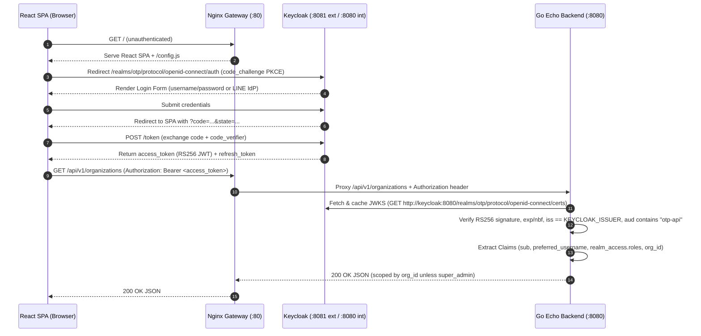

# Phase 1.2 — Authentication & Authorization Flow Design (Keycloak OIDC)

## 1. Architecture Overview
- **Identity Provider (IdP)**: Keycloak (`realm: otp`)
- **Frontend SPA**: React + Vite (`client_id: otp-web`, public client, Authorization Code Flow + PKCE S256)
- **Resource Server (API)**: Go + Echo (`client_id: otp-api`, bearer-only audience validation)
- **Gateway**: Nginx Reverse Proxy (`http://localhost:80` in local Compose; K8s Ingress/Gateway in production)

## 2. End-to-End OIDC Flow

## 3. Critical Architectural Rule: Internal vs External Keycloak URLs
In containerized environments (Docker Compose and Kubernetes), the browser and the backend reach Keycloak via different network paths:
1. **External Issuer (`KEYCLOAK_ISSUER`)**: `http://localhost:8081/realms/otp` (or `https://auth.example.com/realms/otp` in K8s).
   - Keycloak is configured with `KC_HOSTNAME=http://localhost:8081`, so every JWT it mints carries `"iss": "http://localhost:8081/realms/otp"`.
2. **Internal JWKS URL (`KEYCLOAK_JWKS_URL`)**: `http://keycloak:8080/realms/otp/protocol/openid-connect/certs`.
   - The Go backend inside the container network fetches public keys directly over the internal Docker/K8s service network without going out to the host/internet, while still validating the `iss` claim against `KEYCLOAK_ISSUER`.

## 4. JWT Token Claims & Role Mapping

| Claim | Type | Source in Keycloak | Usage in Go Backend & React SPA |
|---|---|---|---|
| `sub` | `string` (UUID) | User ID | Immutable subject identifier |
| `preferred_username` | `string` | Username | Display & audit |
| `aud` | `string` or `[]string` | Audience Mapper (`otp-api`) | Verified by Go middleware |
| `realm_access.roles` | `[]string` | Realm Roles | RBAC (`super_admin`, `admin`, `finance_staff`, `tabwater_staff`, `recycle_bank_staff`, `foodwaste_staff`, `annual_staff`, `user`) |
| `org_id` | `int64` (optional) | User Attribute Mapper | Tenant scoping (`nil` for `super_admin`, required for tenant staff/users) |

## 5. Error Responses (RFC 7807 `application/problem+json`)
- **401 Unauthorized**: Missing `Authorization` header, malformed Bearer token, expired token, bad signature, wrong `iss` or `aud`.
- **403 Forbidden**: Valid token, but user lacks required role for the route or lacks `org_id` when accessing tenant-scoped data as a non-super-admin.
